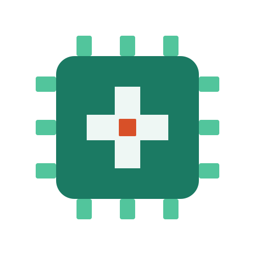

{ .rf-hero__logo }

Under development

# Forging the ultimate retro emulation experience

A lightweight Linux distribution built from the silicon up for retro gaming on Qualcomm Snapdragon handhelds. Boot straight into a gamepad UI, pick a system, pick a game, play.

[Get started](guide/index.md){ .md-button .md-button--primary }
[Supported devices](devices/index.md){ .md-button }

-   :lucide-gamepad-2:{ .lg .middle } __Console-like from power on__

    ---

    No Android launcher, no desktop. RetroForge boots straight into a gamepad-first shell built on OpenGamepadUI.

-   :lucide-cpu:{ .lg .middle } __One image, every device__

    ---

    A single image serves Snapdragon 4 Gen 2 through 8 Elite handhelds. The running system recognises the board and configures itself.

-   :lucide-shield-check:{ .lg .middle } __Immutable, with A/B updates__

    ---

    A read-only root and signed updates installed to the inactive slot. If an update fails to boot, the device rolls back on its own.

-   :lucide-memory-stick:{ .lg .middle } __Leaves Android alone__

    ---

    RetroForge runs from an SD card and does not touch your Android install. Take the card out and the device is exactly as it was.

-   :lucide-zap:{ .lg .middle } __Tuned for the hardware__

    ---

    A unified mainline-based kernel, our own Mesa/Turnip build and per-board profiles for controls, display, audio and power.

-   :lucide-git-branch:{ .lg .middle } __Open source__

    ---

    Everything RetroForge writes is GPL-2.0-or-later and developed in the open on GitHub.

